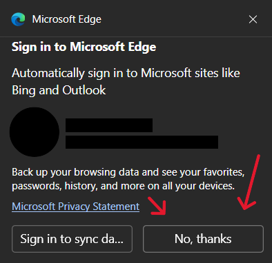
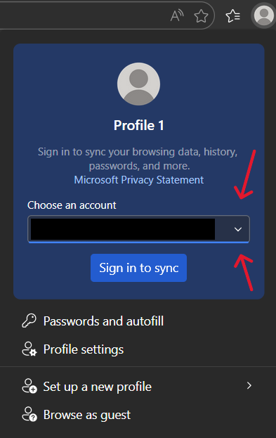
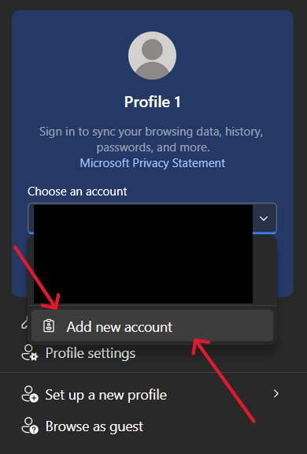
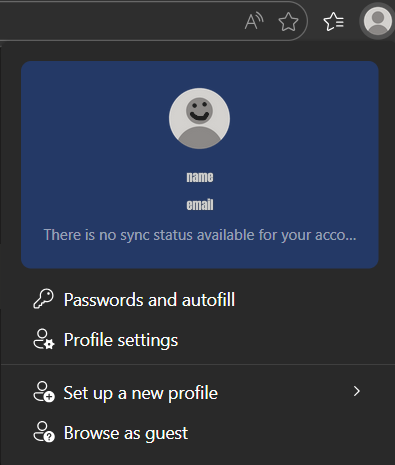
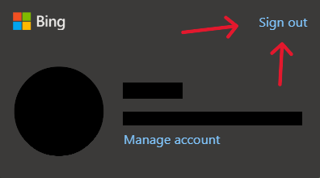
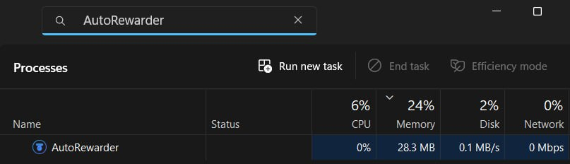

# AutoRewarder — User Guide

Welcome! This guide will help you get started with AutoRewarder and explain all its features. No programming knowledge required.

> [!NOTE]
> **For screenshots and demo, see the [Screenshots & Demo](README.md#screenshots--demo) section in the README.**

---

## Table of Contents

### Getting Started
- [Installation](#installation)
- [First Run & Setup](#first-run--setup)

### Using AutoRewarder
- [Starting a Session](#starting-a-session)
- [Daily tasks only](#daily-tasks-only)
- [Visual Search](#visual-search)
- [What's Happening?](#whats-happening)

### Settings & Automation
- [Understanding the Settings](#understanding-the-settings)
- [Rewards Dashboard](#rewards-dashboard)
- [Hide Browser](#hide-browser)
- [Force daily tasks & visual search](#force-daily-tasks--visual-search)
- [Autostart & Daily Run Time](#autostart--daily-run-time)
- [AI-generated search terms (LLM)](#ai-generated-search-terms-llm)
- [Scheduled runs](#scheduled-runs)
- [Managing accounts](#managing-accounts)
- [About](#about)
- [System Tray & Application Exit](#system-tray--application-exit)

### Activity
- [Search History](#search-history)
- [Statistics Dashboard](#statistics-dashboard)
- [Background logs](#background-logs)
- [Tips & Best Practices](#tips--best-practices)
- [Runtime Data](#runtime-data)

### Troubleshooting & Support
- [Troubleshooting](#troubleshooting)
- [FAQ](#faq)

---

## Installation

AutoRewarder is available for Windows (installer and portable) and Linux.

For download links and installation instructions, please refer to the [Installation](README.md#installation) section in the README.

---

## First Run & Setup

On first launch, AutoRewarder starts with no accounts. You will see an empty state with a **Create your first account** button (or use **Add account** from the header).

### What is First Setup?

First Setup creates a dedicated Edge profile for each account. This keeps it separate from your personal browsing data and lets you manage multiple Rewards accounts safely.

### How to Complete First Setup

1. Click **Create your first account** (or **Add account**)
2. Enter a name for the account
3. Microsoft Edge opens. Sign in to the Rewards account for this profile.

4. Close the browser window when done
5. The account will show as **Ready**

### Multiple Accounts

Adding another account is slightly different, so please follow these steps:

1. Click **Add account**
2. Enter a name for the new account
3. Microsoft Edge opens again, but this time it will suggest you automatically sign in. Do NOT accept the sign-in prompt. Instead, click **No, thanks** or **x**.

4. Then click the profile icon in the top right corner of Edge and choose **Add new account**.

5. After signing in to the new account, the profile tab should look like this:

6. Make sure you see the new account here. If you see the old account, click **Sign out** and sign in with the new account. If you see the new one, just refresh the page and it should show as signed in.

> [!IMPORTANT]
> Go to the Rewards dashboard and accept terms and cookies for the new account to make sure it's fully set up.

7. Close the browser window when done

> [!NOTE]
> Repeat this to add more accounts.

---

## How to Use

### Starting a Session

1. Open AutoRewarder.exe
2. Select an account from the dropdown
3. Set PC and Mobile query counts (PC 0-130, Mobile 0-99). Set one to 0 to skip it. Your preferred search limits are saved automatically and will load on your next launch.
4. *(Optional)* Toggle **"Advanced scheduling"** to spread searches across a longer duration (see [Scheduled runs](#scheduled-runs) for details)
5. *(Optional)* Configure the minimum and maximum delay between manual searches (see [Manual Search Delays](#manual-search-delays) for details)
6. *(Optional)* Toggle **"Daily tasks only"** to skip searches and only collect dashboard click-through tasks
7. Click the **"Start run"** button
8. Watch the status indicator show that AutoRewarder is working
9. The terminal-like window below shows what's happening in real-time
10. To interrupt the run at any time, click the **"Stop"** button — the browser will close cleanly and no orphan processes are left behind

> [!TIP]
> Closing the main window sends AutoRewarder to the system tray. Use the tray icon to reopen the window or choose **Exit** to fully close the app.

### What's Happening?

- AutoRewarder opens Microsoft Edge (you can see it if hide-browser is off)
- It performs random searches from a built-in list of +10k real search queries (from a google-trends dataset) or from your own LLM provider (if enabled)
- Each search has human-like delays and behavior
- It runs the PC phase first, then the Mobile phase (iPhone emulation)
- It may occasionally switch to Images/Videos/News tabs
- It may take short "coffee breaks" during longer sessions
- If Schedule is enabled and Advanced scheduling is on, the run is paced across the schedule duration using the queries-per-hour target. You will see a clear "Done!" message in the logs when the advanced scheduling run fully completes.
- After the PC phase, it collects Daily Set + "More Activities" click-through tasks (once per day, per account). Locked cards, sweepstakes and promo banners are automatically skipped — only point-earning tasks are clicked
- If the Visual Search task isn't completed, it will be completed as part of the daily task flow or after PC phase.
- The process continues until all searches are complete, or until you click **Stop**
- You'll see updates in the log window

If a new version is available, AutoRewarder can show an update notification and a download link.

### Daily tasks only

If you've already done your searches manually (or just want to clean up the dashboard quickly), enable the **"Daily tasks only"** toggle before starting. The run skips both Bing search phases and goes straight to the Rewards dashboard to harvest the Daily Set/More Activities cards + Visual Search task.

Anything already marked as done for today is skipped, and the log says so — see [Force daily tasks & visual search](#force-daily-tasks--visual-search) to run it again anyway.

### Visual Search

This feature uses a rotating pool of base images, random cropping, and varied JPEG compression to create a large number of distinct upload variants, which helps the bot behave more like a real user while reducing the chance of hash-based detection.

The visual-search flow is designed to:
- run as part of the daily task cycle or after the PC phase, if the task is not already completed
- start from the Rewards **"Visual search streak"** mission's own link, read off your dashboard — Rewards credits the mission only for a search started there, so a search from a bare `bing.com` runs without ever ticking it
- produce 54,684 unique variations per image, generating over 1.6 million different upload variants to keep your account safe
- keep the process human-like with natural mouse movement, randomized delays, and natural page scrolling after upload
- re-read the mission's progress afterwards (`Activity: 0/1` → `1/1`) and leave the day unmarked when Rewards did not count the search, so the next run tries again

> [!NOTE]
> The app tracks visual-search completion per day and per account, so the task does not get repeated. Enable **"Force visual search"** in the Settings window to run it again anyway.

### After Completion

- The **"Start"** button will become enabled again
- You can start another session or close the app
- Your search history is saved automatically
- If you stopped the run via **Stop**, partial progress is kept (whatever searches and daily-task clicks already happened are credited as usual)
- Closing the window sends AutoRewarder to the system tray; use the tray icon to reopen or **Exit** to fully close the app

---

## Understanding the Settings

Open the Settings window with the gear icon in the top-right corner. The left-hand navigation has two parts: **Application** sections (General, Daily tasks, Search terms) and one entry per **account**. Each account page gathers everything about that account — rename, re-run setup, delete, its Rewards dashboard and its scheduled run. Sections you have edited show a marker in the navigation, and the footer counts the pending changes until you click **Save**.

### Rewards Dashboard

This per-account setting lives at the top of each account page (**Settings → Accounts → _account_ → Microsoft Rewards**). It determines which version of the Microsoft Rewards page layout the bot should interact with. You can choose from the following options:

- **Auto (detect):** The bot will automatically identify and use the correct dashboard layout for your account.
- **Legacy:** Forces the bot to use the older Rewards dashboard layout.
- **New:** Forces the bot to use the updated, new Rewards dashboard layout.

### Hide Browser

This toggle controls whether you can see Microsoft Edge while searches are happening.

- **OFF (default)**: You'll see Edge browser window performing searches
- **ON (hide-browser mode)**: Edge runs in the background, you only see the log window

**Why would you use hide-browser?**
- Less distracting if you're working on something else
- Slightly faster performance since it doesn't have to render the browser window what will save system resources (RAM/CPU)

### Manual Search Delays

In **Settings → General**, you can configure the random delay between manual search queries.

- **Minimum delay** — the shortest possible pause between searches
- **Maximum delay** — the longest possible pause between searches
- Allowed values range from **0 to 1,800 seconds**
- The default range is **4–10 seconds**

For each search, AutoRewarder randomly selects a delay between the configured minimum and maximum values. This allows you to make manual search runs faster or spread them out more gradually.

The values are saved in the application settings and reused during future manual runs.

> [!NOTE]
> These settings apply to normal manual runs only. Scheduled runs and runs using Advanced Scheduling from GUI use their own pacing rules and do not use the configured manual delay range.

### Force daily tasks & visual search

AutoRewarder records, per account and per day, that the Daily Set and the Visual Search have been done, so a second run of the same day skips them. Two toggles in the **Daily tasks** section of the Settings window let you override that record:

- **Force daily tasks:** runs the Daily Set and More Activities even when today is already marked as done. Cards that are genuinely complete are still skipped by the card-level detection, so a forced run on a real already-done day just confirms the state.
- **Force visual search:** runs the visual search even when today is already marked as done. A different image is picked each time, so nothing is uploaded twice.

Both are **off by default**, which keeps the normal behaviour: what already ran today is not redone. Turn one on when you don't trust the saved status — for instance a task that was marked as done but did not credit.

### AI-generated search terms (LLM)

By default, AutoRewarder draws its searches from a large built-in list of English queries. If you'd prefer searches that look natural in **your own language**, enable **"Generate search terms with AI (LLM)"** in the **Search terms** section of the Settings window and provide your own LLM API key (bring-your-own-key).

- **Provider & model:** Choose OpenAI, OpenAI-compatible, Anthropic, or Google Gemini. Leave the model on **Default** to use a sensible model for that provider, or click the refresh button next to the model field: it asks the provider which models your key can use and lets you pick one from the list, so you can follow new releases without typing anything. **Custom…** still lets you enter a model id by hand.
- **Base URL (OpenAI-compatible only):** Enter the endpoint URL for services that expose an OpenAI-style API (e.g. Groq, OpenRouter, or a local server) such as `https://api.example.com/v1`. Used for both query generation and model discovery. If the URL does not end in `/v1`, AutoRewarder appends it automatically.
- **API key:** Paste a key from your chosen provider — the **Get an API key** link under the field opens the right page (OpenAI Platform, Anthropic Console or Google AI Studio). The key is stored locally in your `settings.json` (plain text) and is only sent to that provider to request queries or list its models — no personal data is shared.
- **Language:** Leave **`auto`** to follow the language of the computer running AutoRewarder (detected automatically), or type a locale such as `fr-FR`, `it-IT`, or `en-US` to force one.

On each run, AutoRewarder asks the provider for a fresh batch of queries in your language. If generation fails for any reason — no key, an invalid key, an exceeded quota, or no internet — it falls back to the built-in list, so your run always completes.

> [!NOTE]
> Using an LLM provider may incur costs on your provider account, depending on their pricing. Query generation uses very few tokens per run.

### Autostart & Daily Run Time
When enabled, AutoRewarder uses your operating system's native task scheduler (Windows Task Scheduler or Linux systemd) to launch headless runs in the background.

- **Independent Schedules:** You can set a specific **Daily run time** (HH:MM) for each account individually on its account page in Settings.
- **Missed Run Catch-up:** If your computer is turned off or asleep during a scheduled time, the run is not lost. The system will automatically catch up and execute the task as soon as the computer is available again.
- **Smart Deduplication:** If you manually start a run before a delayed catch-up task fires, AutoRewarder detects this and safely skips the scheduled run to prevent double execution.

To disable automated background runs, turn off **Enable Background Auto-Run** or disable scheduling for specific accounts.

> [!TIP]
> **For Multi-Account Users:** If you have multiple accounts configured, it is **highly recommended to stagger their run times**. Since accounts have independent OS tasks, setting them to the exact same time will launch them at the same time, which spikes RAM/CPU usage and can look suspicious to Microsoft (if from the same IP).

### Managing accounts

Every account has its own page in Settings, listed under **Accounts** in the left-hand navigation (the dot next to a name is green when its schedule is on and amber while its first setup is still pending). From the page header you can **rename** the account, **re-run its setup** (for example after the Edge profile got corrupted) or **delete** it — deleting removes the browser profile, history and daily-set status for good. **Add account** at the bottom of the list starts the setup flow for a new account. Switching the active account is still done from the account picker on the main screen.

### About

The **About** section shows the installed version, lets you **check for updates** on demand, opens the folder where AutoRewarder keeps its data (profiles, `settings.json`, background logs) and links to the GitHub repository.

### System Tray & Application Exit
By default, clicking the "X" on the main window sends AutoRewarder to the system tray. This allows the application to remain active for background tasks.

- You can click the tray icon to reopen the interface, or right-click it and select **Exit** to fully terminate the process.
- **Close to tray toggle:** If you prefer the application to completely shut down when you click the "X" button, disable the **"Close to tray"** option in the General Settings.
- *Note: Changing the "Close to tray" setting requires an application restart to take effect.*

### How to check if it's running or stop it (Task Manager)

If the AutoRewarder window is open, the in-app **Stop** button is the cleanest way to halt a run — it closes the browser, kills the WebDriver, and leaves no orphan Edge processes behind.

For background runs (Autostart or CLI mode) where there's no visible window, use Task Manager:

**To check status or force stop:**
1. Open **Task Manager** (`Ctrl + Shift + Esc`).
2. Look for `AutoRewarder.exe` in the **Processes** tab.
3. If it's there, the bot is active.
4. To stop the bot, right-click `AutoRewarder.exe` and select **End task**.

> [!NOTE]
> If you see the process using some CPU and Network, it means it's currently performing searches.

### Scheduled runs

Each account has its own page in the Settings window (pick it under **Accounts** in the left-hand navigation); the **Scheduled run** group sits at the bottom of that page. The main schedule toggle turns on automated background runs, but it also controls how your manual GUI runs behave.

> [!NOTE]
> The manual search delay settings do not affect scheduled runs. Standard scheduled runs and Advanced Scheduling use their own pacing logic.

**Standard Schedule**
Turn on the main Schedule toggle, but leave Advanced scheduling *off*. The bot will run automatically at the configured time for this account, processing the PC and Mobile queries in one go.

**Advanced Scheduling**
Turn on **both** the **Schedule toggle** and the **Advanced scheduling** toggle. This changes the bot's behavior entirely: instead of doing all searches at once, it safely spreads your queries across the specified **Run duration**. To mimic human behavior, the breaks between batches are randomized (+/- 25%), meaning the actual total run time will naturally vary (e.g., a 3-hour schedule may finish in 2.5 to 3.5 hours).

You can use scheduling in two ways:
* **Automated Background Runs:** Runs triggered automatically when using **Background Auto-Run** or headless CLI.
* **Manual GUI Runs:** If **Advanced scheduling** and the **Schedule toggle** are enabled in the settings, clicking the **Start** button on the main screen will respect these settings. It will spread the total queries across your specified run duration.

*(Note: If the Schedule toggle is OFF, manual GUI runs will always use the classic run).*

> [!WARNING]
> **Safety First:** If your `QUERIES / HOUR` setting and `RUN DURATION` conflict (for example, setting 30 QPH for 90 total but a long 9-hour duration), the bot will prioritize the **Run duration**. It will stretch your searches over the entire time period to look like a natural human user and keep your account safe.

> [!IMPORTANT]
> Make sure that your PC is connected to the internet and does not go to sleep while the bot is running.

---

## Search History

AutoRewarder keeps track of all searches it has performed.

1. In the main AutoRewarder window, click **History** button
2. A new window opens showing:
   - **Date** — when the search was performed
   - **Time** — exact time
   - **Query** — what was searched
   - **Status** — success/failure

## Statistics Dashboard

Click the **Stats** card on the main screen to open the statistics dashboard.

The dashboard shows:

- current scraped Microsoft Rewards points balance;
- points earned during the last run;
- PC and Mobile search totals;
- Daily Set and other task activity;
- per-day activity charts;
- a summary across multiple accounts.

## Background logs

To view background logs, click **Background logs** in the Activity section of the main window. The log window shows output from scheduled and headless runs and includes a **Refresh** button.

> [!NOTE]
> You can find the file paths for your raw history, background logs, and settings in the [Runtime Data](#runtime-data) section.

---

## Tips & Best Practices

### ✅ Do's

- Start with a small number (5-10 searches) on your first try to test
- Let the app run uninterrupted for best results
- Check your internet connection before starting

### ❌ Don'ts

- Don't do all your searches in one quick burst. Rushing your searches can trigger the anti-fraud systems.
- Don't manually interact with the AutoRewarder Edge profile while it is running (you can still use your main profile)
- Don't use Bing while AutoRewarder is performing searches (it may be detected as unusual activity)
- Don't force-close the app while a session is running
- Don't modify files in runtime directories manually
- Don't run multiple AutoRewarder instances simultaneously
- Don't run multiple accounts at the same time
- Don't run multiple accounts from the same IP address

### Recommended Usage

To keep your accounts safe and avoid detection, we highly recommend following one of these methods:
1. **Use Advanced Scheduling:** Automate your searches to safely space them out.
2. **Set a Realistic Run Duration:** Give the bot enough time (e.g., several hours) to naturally spread out the queries across the day.
3. **Manual Alternative:** If you prefer not to use the advanced scheduler, run the bot manually in several short sessions at different times throughout the day, rather than doing everything at once.
4. **Mix up your searches:** Vary the number of searches each time to mimic natural behavior.
5. **Use hide-browser mode:** Enable this if you want to do other work while the bot runs in the background.

## Runtime Data

AutoRewarder stores your settings, search history, logs, and account profiles in a dedicated data folder. Depending on your OS and whether you use a portable version, these files are located in different directories.

If you need to access these files directly (e.g., for backup or troubleshooting), see the [Runtime Data](README.md#runtime-data) section in the README for paths and directory structures.

---

## Troubleshooting

**Edge WebDriver not found or outdated:**
- Ensure Microsoft Edge is installed
- Try restarting the application (Selenium Manager will auto-download driver)
- Check that Edge version is up to date
- In **Settings**, open the affected account under **Accounts** and choose **Re-run setup**

**`session not created: DevToolsActivePort file doesn't exist` / Edge failed to start:**
- Close AutoRewarder and any Edge windows
- Kill all Edge and WebDriver processes:
  - **Windows:** Open Task Manager and end all `msedge.exe` processes (and `msedgedriver.exe` if present).
  - **Linux:** Run `pkill -f msedge` and `pkill -f msedgedriver` in your terminal.
- Open Edge normally and complete any pending updates at `edge://settings/help`
- Re-run AutoRewarder
- If it still fails, open the account in **Settings** and choose **Re-run setup**

**Application crashes on startup:**
- In **Settings**, open the affected account under **Accounts** and delete it or re-run its setup
- Verify dependencies: `pip install -r requirements.txt` if running from source
- Check system logs for error details:
  - **Windows:** Check Windows Event Viewer.
  - **Linux:** Run the app from the terminal to see the traceback output directly.

**Searches not completing:**
- Verify internet connection
- Check that Edge is not blocked by antivirus/firewall

**"No account selected" or "Setup pending":**
- Add an account and complete First Setup before starting

---

### Need Help?

If your issue isn't listed, please open an issue on GitHub.

---

## FAQ

**Q: Is AutoRewarder safe?**

A: AutoRewarder is completely free of viruses and malware. The project is fully open-source, so you are welcome to inspect the code yourself. It also isolates its activity in a separate browser profile to protect your personal data.

**Q: Will this ban my Microsoft Rewards account?**

A: Microsoft Rewards' Terms of Service prohibit automation. Use at your own risk.
AutoRewarder is designed to mimic human behavior using advanced scheduling, realistic search queries, and W3C Actions (Bezier curves, human-like typing) to reduce the risk of detection. However, there is always a possibility of account suspension if detected such as searching with Bing while AutoRewarder is running or running multiple sessions at the same time.

**Q: How many searches can I do per day?**

A: You can run as many sessions as you want. The UI allows PC (0-130) and Mobile (0-99) per run, but Microsoft Rewards limits depend on region and account status. Running additional sessions may increase the risk of account restrictions.

**Q: Why does it ask me to do First Setup?**

A: First Setup creates a separate browser profile for each account. You only need to run it once per account.

**Q: What if the app freezes?**

A: You can force-close it (Ctrl+Alt+Delete → Task Manager → AutoRewarder → End Task). Your history/settings will be preserved.

**Q: Why doesn't the app close when I click X?**

A: Closing the window sends AutoRewarder to the system tray so it can keep running. Use **Exit** in the tray menu to fully close the app.

**Q: Can I run this on Mac or Linux?**

A: AutoRewarder officially supports Windows (installer and portable) and Linux (standalone executable). You can download the pre-built archives for both platforms from the [Releases page](https://github.com/safarsin/AutoRewarder/releases/latest). macOS is not officially supported.

---

**Last Updated**: October 2026

**Version**: 4.3

Enjoy using AutoRewarder! 🎉
